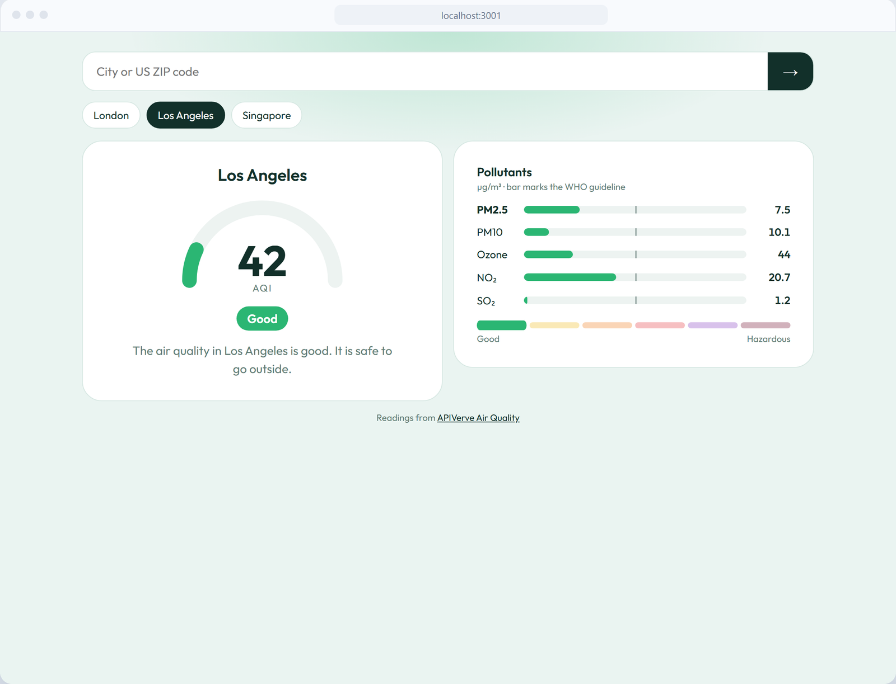

# Air Quality | APIVerve Template

[](LICENSE)
[](package.json)
[](tsconfig.json)
[](https://apiverve.com/marketplace/airquality?utm_source=github&utm_medium=template&utm_campaign=air-quality-nextjs-tutorial)

An air quality app you can deploy in one click. Search any city or US ZIP code and get an AQI score on a colour-coded gauge, what it means for going outside, and each pollutant measured against the WHO guideline. Your recent places stay one tap away.

[](https://vercel.com/new/clone?repository-url=https%3A%2F%2Fgithub.com%2Fapiverve%2Fair-quality-nextjs-tutorial&project-name=air-quality&repository-name=air-quality&env=APIVERVE_API_KEY&envDescription=Your%20APIVerve%20API%20key.%20Free%20to%20create%2C%20no%20card%20needed.&envLink=https%3A%2F%2Fdashboard.apiverve.com%2Fsignup%3Fapi%3Dairquality%26utm_source%3Dvercel%26utm_medium%3Dtemplate%26utm_campaign%3Dair-quality-nextjs-tutorial)



---

### Get your free API key

This template needs an APIVerve API key. **[Sign up free](https://dashboard.apiverve.com/signup?api=airquality&utm_source=github&utm_medium=template&utm_campaign=air-quality-nextjs-tutorial)**, no credit card required.

---

## Deploy in one click

Click **Deploy with Vercel** above. Vercel copies this repo to your GitHub account, asks for your `APIVERVE_API_KEY`, and gives you a live URL about a minute later.

## Run it locally

```bash
git clone https://github.com/apiverve/air-quality-nextjs-tutorial.git
cd air-quality-nextjs-tutorial
npm install
cp .env.example .env   # then set APIVERVE_API_KEY in .env
npm run dev
```

Open `http://localhost:3000`. To see it in a phone and a browser frame side by side, open `http://localhost:3000/showcase.html`.

## How it works

1. `app/page.tsx` is the search box, your saved places, the AQI gauge and the pollutant bars. It opens on `?city=London`, or the first of your saved places.
2. `app/api/air/route.ts` treats five digits as a US ZIP code and anything else as a city, then calls Air Quality. Your API key stays on the server and never reaches the browser. Answers are cached for 15 minutes, and cached answers don't count against the rate limit.
3. `lib/aqi.ts` turns the PM2.5 reading into a US EPA AQI score and colour, so the gauge works on every plan. When your plan includes the API's own AQI, the page uses that instead.

On a free key you get PM2.5, PM10 and the health note, and the app works out the AQI score from PM2.5. Paid plans add ozone, NO₂, SO₂ and carbon monoxide, the official AQI and category, and the main pollutant, which the page bolds.

```
app/
  api/air/route.ts    the server route: validates, calls Air Quality, caches
  page.tsx            search, saved places, the gauge and pollutant bars
  layout.tsx          font and metadata
  globals.css         the look, with container queries for phone and desktop
lib/
  apiverve.ts         API call, cache and rate limit helpers
  aqi.ts              PM2.5 to AQI, and the six AQI levels
public/showcase.html  the phone and desktop demo frame
```

### The API call

```ts
const res = await fetch('https://api.apiverve.com/v1/airquality?city=London', {
  headers: { 'x-api-key': process.env.APIVERVE_API_KEY! }
});
const { data } = await res.json();
```

## Before you share your URL

Once deployed, anyone who finds your URL can use it on your API key. Each visitor can make 10 uncached requests a minute, and repeat lookups come from the cache, which is fine for a demo. Both are kept in memory, so they aren't shared between serverless instances. For production:

- Put the page behind your own sign-in, or
- Move the limit and cache to a shared store such as [Upstash Redis](https://upstash.com/), or
- Call the route only from your own backend.

## Ideas to extend it

- Add today's forecast with [Weather](https://apiverve.com/marketplace/weatherforecast) so people can plan a run or a walk.
- Show the pollen and weather alerts for the area with [Weather Alerts](https://apiverve.com/marketplace/weatheralerts).
- Look up air quality for your visitor automatically with [IP Lookup](https://apiverve.com/marketplace/iplookup).

## API reference

- [Air Quality](https://apiverve.com/marketplace/airquality?utm_source=github&utm_medium=template&utm_campaign=air-quality-nextjs-tutorial): `GET https://api.apiverve.com/v1/airquality`
- [Full documentation](https://docs.apiverve.com?utm_source=github&utm_medium=template&utm_campaign=air-quality-nextjs-tutorial)

## Tech stack

- **Next.js 16** (App Router) and **React 19**, in **TypeScript**
- A **Route Handler** in `app/api/` for the server side, so the key never reaches the browser
- Deploys to Vercel as-is, with no configuration

## License

MIT. See [LICENSE](LICENSE).
